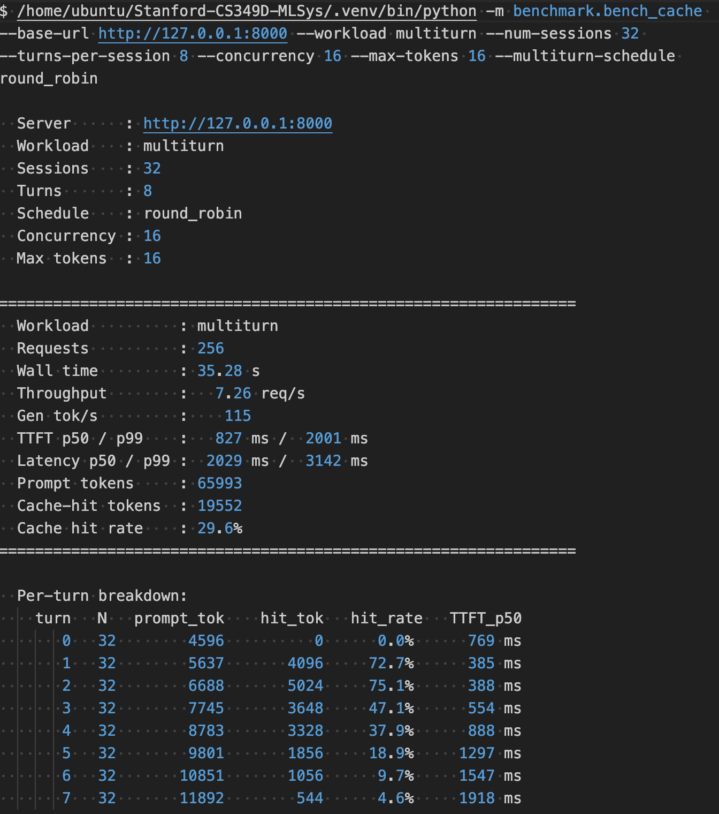
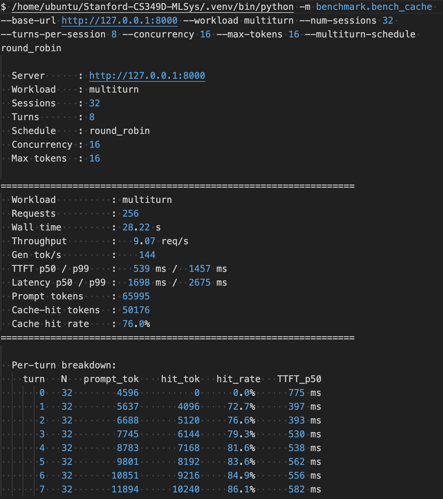
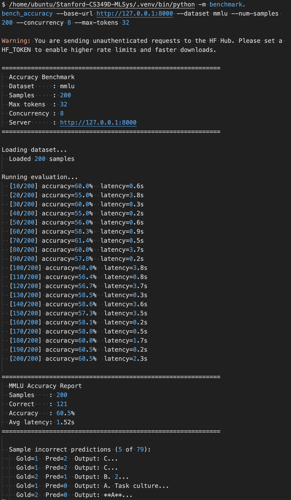
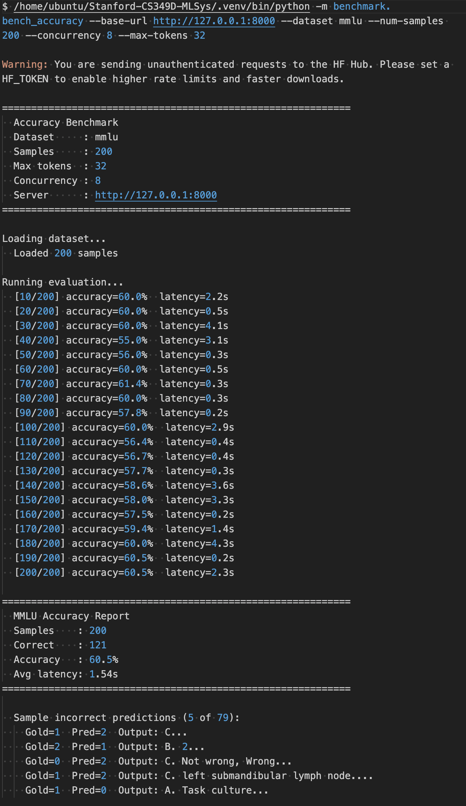
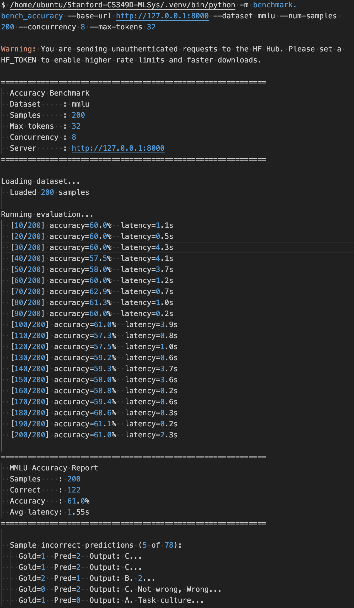

# HiRadixCache: A Hierarchical GPU and CPU KV Cache for Multi-Turn LLM Serving

Author: Thomason Zhao (changyuz@stanford.edu) and Joey Ji (junyiji3@stanford.edu)

## Abstract

This project implements Track 1 of Milestone 4: a hierarchical radix-prefix KV cache, called HiRadixCache, on top of the Milestone 3 serving engine. The Milestone 3 engine already supports paged KV memory, PagedAttention, chunked prefill, continuous batching, request retraction, and a GPU-only radix prefix cache. Its main limitation is capacity: when the GPU KV cache fills, least recently used radix entries are evicted from HBM and their cached prefixes are lost. On long multi-turn workloads, this causes the hit rate to collapse once the active conversation working set exceeds the GPU KV pool.

HiRadixCache adds a second KV tier in pinned CPU memory. GPU cache eviction no longer immediately discards cached prefixes. Instead, unlocked GPU-resident radix nodes are demoted to the CPU tier. Later prefix matches against CPU-resident nodes promote their KV pages back to GPU memory before request execution. The implementation preserves the original scheduler-facing radix cache interface, so chunked prefill, paged attention, batching, and request retraction remain enabled.

The final evaluation was run on an NVIDIA L4 serving Qwen/Qwen3-8B. The GPU KV pool was intentionally constrained to 0.97 GB, while HiRadixCache used a 12.00 GiB pinned CPU tier, more than 10x the GPU KV capacity. On a 32-session, 8-turn round-robin multi-turn workload, the GPU-only baseline starts at a 72.7% turn-1 hit rate but falls to 4.6% by turn 7. HiRadixCache preserves a high hit rate across the same workload, reaching 86.1% at turn 7. With async copy overlap enabled, HiRadixCache improves end-to-end request throughput by 24.9%, generated-token throughput by 25.2%, and median time-to-first-token by 34.8% relative to the Milestone 3 GPU-only baseline.

## 1. Introduction

KV caching is central to efficient autoregressive LLM serving. During prefill, the model computes key and value tensors for every prompt token. During decode, the model reuses those tensors instead of recomputing attention over the full prompt. A prefix cache extends this idea across requests: if a new request shares a prefix with an earlier request, the engine can reuse the cached KV for that prefix and only prefill the suffix.

Milestone 3 implemented this reuse with a radix prefix tree backed entirely by GPU memory. This works well when the active prefix working set fits in HBM. However, realistic workloads often have reuse distances longer than the GPU cache capacity. Multi-turn chat is a good example: each conversation reuses its own earlier turns, but many other sessions may run before the conversation's next turn arrives. When the GPU cache is too small for all active sessions, the baseline evicts old radix leaves and future turns must recompute prefixes from scratch.

The goal of this milestone is to implement the GPU + CPU portion of HiCache: a hierarchical KV cache in which GPU eviction demotes KV pages to CPU DRAM rather than dropping them. CPU memory is slower than GPU memory, but it is much larger. This changes the capacity tradeoff: a request may pay PCIe copy cost to rehydrate a cached prefix, but it can avoid the much larger cost of running the model over the entire prefix again.

## 2. Baseline Serving Engine

The starting point was the Milestone 3 engine. The relevant baseline features are:

| Feature                | Baseline behavior                                                                                                              |
| ---------------------- | ------------------------------------------------------------------------------------------------------------------------------ |
| Paged KV pool          | KV memory is divided into fixed-size GPU pages. Each page stores K/V tensors for a fixed number of tokens.                     |
| PagedAttention         | Request page tables map logical prompt positions to physical GPU KV pages.                                                     |
| Chunked prefill        | Long prompts can be prefetched in chunks instead of monopolizing the scheduler.                                                |
| Continuous batching    | Prefill and decode requests are scheduled together across active requests.                                                     |
| Request retraction     | Requests can be temporarily retracted when memory pressure requires their pages.                                               |
| GPU radix prefix cache | Completed prompt pages are stored in a radix tree so future requests with shared prefixes can skip prefill for matched tokens. |

The GPU-only radix cache stores page IDs from the GPU KV pool in radix nodes. When the GPU allocator needs pages, it asks the radix cache to evict unlocked least-recently used entries. The baseline eviction path drops those entries and returns their pages to the GPU free list. This is simple and correct, but it destroys reuse once the working set exceeds the GPU KV pool.

## 3. Experimental Setup

All final measurements use the same model, hardware, and workload except for the cache configuration.

### 3.1 Hardware and Model

| Item                       | Value                      |
| -------------------------- | -------------------------- |
| GPU                        | NVIDIA L4                  |
| Reported GPU memory        | 23034 MiB                  |
| Model                      | Qwen/Qwen3-8B              |
| Model parameters           | 8190M                      |
| Model dtype                | bfloat16                   |
| Attention backend          | FlashInfer paged attention |
| Transformer layers         | 36                         |
| Hidden size                | 4096                       |
| Attention heads            | 32                         |
| KV heads                   | 8                          |
| Head dimension             | 128                        |
| Vocabulary size at runtime | 151669                     |

### 3.2 Engine Configuration

| Parameter                      | Value                                |
| ------------------------------ | ------------------------------------ |
| Serving mode                   | paged                                |
| Page size                      | 32 tokens                            |
| Prefill chunk size             | 512 tokens                           |
| Maximum running requests       | 16                                   |
| GPU static memory fraction     | 0.75                                 |
| Static memory budget           | 17.7 GB                              |
| Weights and non-KV memory used | 16.8 GB                              |
| GPU KV pool                    | 206 pages, 205 usable pages          |
| GPU KV pool size               | 0.97 GB                              |
| CPU KV pool for HiRadixCache   | 2730 pages                           |
| CPU KV pool size               | 12.00 GiB                            |
| CPU/GPU KV capacity ratio      | 12.37x by bytes; 13.3x by page count |

The CPU tier therefore satisfies the milestone requirement that HiCache be tested with a CPU cache at least 10x larger than the GPU KV pool.

### 3.3 Workload

The benchmark uses the multi-turn cache workload because it directly stresses prefix reuse over long reuse distances.

| Workload parameter                   | Value               |
| ------------------------------------ | ------------------- |
| Workload type                        | multi-turn chat     |
| Sessions                             | 32                  |
| Turns per session                    | 8                   |
| Total requests                       | 256                 |
| Client concurrency                   | 16                  |
| Maximum generated tokens per request | 16                  |
| Scheduling pattern                   | round robin by turn |

The round-robin schedule runs turn 0 for all 32 sessions, then turn 1 for all 32 sessions, and so on. This preserves the true conversational dependency inside each session because turn `k+1` includes the assistant response from turn `k`. It also increases reuse distance: before a session reaches its next turn, every other active session has run. This is the intended stress case for hierarchical caching. A per-session schedule, where one worker runs an entire conversation before moving on, did not create enough reuse distance to expose the GPU-only capacity cliff.

The benchmark records request count, wall time, request throughput, generated-token throughput, time-to-first-token (TTFT), end-to-end latency, prompt-token count, cache-hit token count, and per-turn cache-hit rate.

### 3.4 Command Configurations

Each evaluation run starts one serving process and then runs the same multi-turn benchmark client against it. The server commands differ only in the cache flags.

GPU-only Milestone 3 baseline:

```bash
python -m miniengine \
  --model Qwen/Qwen3-8B \
  --host 127.0.0.1 \
  --port 8000 \
  --dtype bfloat16 \
  --mode paged \
  --mem-fraction-static 0.75 \
  --page-size 32 \
  --prefill-chunk-size 512 \
  --max-running 16 \
  --cpu-cache-size-gb 0
```

HiRadixCache with blocking CPU-tier copies:

```bash
python -m miniengine \
  --model Qwen/Qwen3-8B \
  --host 127.0.0.1 \
  --port 8000 \
  --dtype bfloat16 \
  --mode paged \
  --mem-fraction-static 0.75 \
  --page-size 32 \
  --prefill-chunk-size 512 \
  --max-running 16 \
  --cpu-cache-size-gb 12.0
```

HiRadixCache with async copy overlap:

```bash
python -m miniengine \
  --model Qwen/Qwen3-8B \
  --host 127.0.0.1 \
  --port 8000 \
  --dtype bfloat16 \
  --mode paged \
  --mem-fraction-static 0.75 \
  --page-size 32 \
  --prefill-chunk-size 512 \
  --max-running 16 \
  --cpu-cache-size-gb 12.0 \
  --hicache-overlap
```

The same client command is used for all three server configurations:

```bash
python -m benchmark.bench_cache \
  --base-url http://127.0.0.1:8000 \
  --workload multiturn \
  --num-sessions 32 \
  --turns-per-session 8 \
  --concurrency 16 \
  --max-tokens 16 \
  --multiturn-schedule round_robin
```

For the accuracy no-regression check, the same three server configurations are used with the MMLU accuracy client:

```bash
python -m benchmark.bench_accuracy \
  --base-url http://127.0.0.1:8000 \
  --dataset mmlu \
  --num-samples 200 \
  --concurrency 8 \
  --max-tokens 32
```

## 4. HiRadixCache Design

HiRadixCache extends the radix prefix cache with two storage tiers:

| Tier     | Storage                               | Purpose                                                      |
| -------- | ------------------------------------- | ------------------------------------------------------------ |
| GPU tier | Existing GPU KV page pool             | Fast path for prefixes immediately usable by PagedAttention. |
| CPU tier | Preallocated pinned host KV page pool | Larger backing cache for prefixes evicted from GPU memory.   |

Each radix node has an explicit tier. A GPU node owns GPU page IDs. A CPU node owns CPU page IDs. A third transient state, pending-CPU, is used during async demotion: the node is logically being demoted, but its GPU pages cannot be freed until the device-to-host copy has completed.

### 4.1 API Compatibility

The scheduler and engine continue to use the same logical cache operations:

```text
match_prefix(tokens) -> matched token count and GPU page IDs
insert_and_return(tokens, pages) -> radix node and redundant pages
evict(required_gpu_pages) -> number of GPU pages made available
inc_lock_ref(node)
dec_lock_ref(node)
num_evictable_pages()
reset()
```

This compatibility is important. It means HiRadixCache is layered underneath the existing serving engine rather than replacing the scheduler. Chunked prefill, paged attention, request retraction, and continuous batching continue to operate on GPU page IDs exactly as before.

### 4.2 Core Invariants

The implementation maintains the following invariants:

1. Request page tables contain only GPU page IDs.
2. A cache lookup never returns CPU page IDs to the scheduler.
3. If a matched prefix is CPU-resident, it is promoted to GPU first.
4. GPU pages are not freed until any pending D2H demotion copy is complete.
5. CPU pages are not freed until any pending H2D promotion copy is complete.
6. Nodes with active lock references are not demoted, evicted, or dropped.
7. CPU eviction drops only unlocked CPU-resident nodes.
8. The GPU allocator is allowed to reclaim GPU pages only after the cache has
   made those pages safe to reuse.

These invariants are the main correctness boundary. PagedAttention only knows how to consume GPU KV pages; therefore the CPU tier is invisible to request execution except through promotion.

### 4.3 CPU KV Pool

The CPU tier is a preallocated pinned-memory pool with the same page layout as the GPU KV pool. For each transformer layer, the pool allocates separate K and V tensors with shape:

```text
(num_cpu_pages, page_size, num_kv_heads, head_dim)
```

For the final run:

```text
num_cpu_pages = 2730
page_size = 32
num_kv_heads = 8
head_dim = 128
dtype = bfloat16
layers = 36
```

The resulting CPU tier is 12.00 GiB. Pinned host memory is required for non-blocking host-to-device copies. Without pinned memory, the runtime cannot reliably overlap CPU/GPU transfer with other CUDA work.

### 4.4 Demotion

Demotion is triggered when the GPU allocator needs free KV pages. The cache selects least-recently used unlocked GPU nodes. In the blocking implementation, demotion proceeds as:

```text
for each selected GPU radix node:
    allocate CPU pages
    copy K/V tensors for all layers from GPU pages to CPU pages
    change node tier from GPU to CPU
    replace node page IDs with CPU page IDs
    free old GPU pages
```

This preserves the cached prefix while making GPU pages available to the allocator. If the CPU tier is full, HiRadixCache first evicts unlocked LRU CPU nodes. CPU eviction drops the node entirely because there is no lower storage tier in this milestone.

### 4.5 Promotion

Promotion is triggered during prefix lookup. If lookup reaches a CPU-resident node, HiRadixCache promotes it before returning the match:

```text
for each matched CPU radix node:
    allocate GPU pages
    copy K/V tensors for all layers from CPU pages to GPU pages
    change node tier from CPU to GPU
    replace node page IDs with GPU page IDs
    free old CPU pages after the copy is complete
return GPU page IDs to the request
```

After promotion, the request proceeds exactly like a normal GPU-cache hit. The matched prefix pages are appended to the request page table, and prefill starts from the first unmatched prompt token.

### 4.6 Concurrency and Locks

The baseline cache already uses lock references to prevent eviction of cache nodes currently being used by active requests. HiRadixCache preserves that pattern. After a request matches a prefix, the scheduler increments the matched node lock reference. The reference is decremented when the request finishes or is retracted.

HiRadixCache extends the same rule to tier transitions. A locked node is not eligible for GPU demotion or CPU eviction. During promotion, the node is also temporarily protected so another allocator path cannot concurrently demote or drop it while ownership is changing.

### 4.7 Async Overlap

The bonus implementation adds non-blocking copies on a dedicated CUDA copy stream. The design distinguishes two cases:

Device-to-host demotion:

```text
allocate CPU pages
record copy-start event on copy stream
launch non-blocking D2H K/V copies on copy stream
record copy-end event on copy stream
mark node as pending-CPU
return later to poll the copy-end event
only after completion:
    switch node to CPU tier
    free old GPU pages
```

Host-to-device promotion:

```text
allocate GPU pages
record copy-start event on copy stream
launch non-blocking H2D K/V copies on copy stream
record copy-end event on copy stream
make the current compute stream wait for the copy-end event
switch node to GPU tier
free old CPU pages after completion
```

Demotion has the clearest overlap opportunity because the demoted prefix is not needed by the current request once the copy has been submitted. Promotion is more constrained: the promoted pages are needed before the request can consume them, so the model stream must wait before using those pages. Even so, the host thread can submit promotion copies without blocking, and the copy can overlap with unrelated CUDA work already in flight.

The overlap implementation records submitted/completed copy counts, copy time, host wait time, hidden time, and hidden ratio:

```text
hidden_time = max(0, copy_time - host_wait_time)
hidden_ratio = hidden_time / copy_time
```

These counters are not a full replacement for an Nsight timeline, but they directly measure whether the host had to block on copy completion and whether the async events completed without forcing synchronous waiting.

## 5. Implementation Summary

The final implementation consists of the following logical pieces:

| Component              | Responsibility                                                                                   |
| ---------------------- | ------------------------------------------------------------------------------------------------ |
| Tier-aware radix node  | Stores key span, child edges, lock reference count, LRU state, page IDs, and storage tier.       |
| CPU KV memory pool     | Owns pinned host K/V page tensors, a CPU free list, and CPU page allocation/free operations.     |
| HiRadixCache lookup    | Traverses the radix tree, promotes CPU-resident matches, and returns only GPU page IDs.          |
| HiRadixCache insertion | Inserts newly computed GPU pages into the radix tree while preserving radix splitting semantics. |
| GPU demotion path      | Replaces GPU eviction with D2H demotion when the CPU tier has room.                              |
| CPU eviction path      | Drops unlocked LRU CPU nodes when the CPU pool is full.                                          |
| Lock integration       | Keeps the existing lock-reference API so active prefixes are protected.                          |
| Async copy path        | Uses a dedicated CUDA stream and events for overlap-mode demotion and promotion.                 |
| Runtime flags          | `--cpu-cache-size-gb` enables the CPU tier; `--hicache-overlap` enables async copies.            |
| Runtime counters       | Cache-hit, demotion, promotion, CPU eviction, and overlap counters are exported after each run.  |

Two CLI flags control the feature:

| Flag                    | Meaning                                                             |
| ----------------------- | ------------------------------------------------------------------- |
| `--cpu-cache-size-gb 0` | Disable HiRadixCache and run the Milestone 3 GPU-only radix cache.  |
| `--cpu-cache-size-gb N` | Enable HiRadixCache with an N GiB pinned CPU KV tier.               |
| `--hicache-overlap`     | Use the dedicated CUDA copy stream and event-based async copy path. |

The benchmark harness was extended with a round-robin multi-turn schedule. This was necessary to create the reuse distance described in the milestone: many concurrent sessions have active prefixes, but a given session's next turn arrives only after many other sessions have consumed cache capacity.

## 6. Evaluation

Three configurations were evaluated:

| Name                  |  CPU tier | Async overlap | Purpose                                       |
| --------------------- | --------: | ------------: | --------------------------------------------- |
| GPU-only baseline     |  Disabled |            No | Milestone 3 default comparison.               |
| HiRadixCache blocking | 12.00 GiB |            No | Full-credit HiCache behavior without overlap. |
| HiRadixCache overlap  | 12.00 GiB |           Yes | Bonus overlap and end-to-end win run.         |

All three runs completed 256 requests on the same workload. Each request generated up to 16 tokens, so each run generated 4096 completion tokens in total.

### 6.1 GPU-Only Cliff

The first required milestone target is to show a GPU-only cache cliff. The table below is the Milestone 3 GPU-only radix cache. The hit rate starts high once prior turns exist, then collapses as the multi-turn working set exceeds the 0.97 GB GPU KV pool.

| Turn | Requests | Prompt tokens | Cache-hit tokens | Hit rate | TTFT p50 |
| ---: | -------: | ------------: | ---------------: | -------: | -------: |
|    0 |       32 |          4596 |                0 |     0.0% |   769 ms |
|    1 |       32 |          5637 |             4096 |    72.7% |   385 ms |
|    2 |       32 |          6688 |             5024 |    75.1% |   388 ms |
|    3 |       32 |          7745 |             3648 |    47.1% |   554 ms |
|    4 |       32 |          8783 |             3328 |    37.9% |   888 ms |
|    5 |       32 |          9801 |             1856 |    18.9% |  1297 ms |
|    6 |       32 |         10851 |             1056 |     9.7% |  1547 ms |
|    7 |       32 |         11892 |              544 |     4.6% |  1918 ms |

This satisfies the cliff criterion: the GPU-only hit rate is at least 70% on an early turn and below 20% by the end. Specifically, it is 72.7% on turn 1 and 4.6% on turn 7.

Screenshot of raw log output:



### 6.2 HiRadixCache Restores Hit Rate

The second required target is to re-run the same workload with a CPU pool at least 10x larger than the GPU KV pool and show that the hit rate stays high. The table below compares the GPU-only baseline to blocking HiRadixCache.

| Turn | GPU-only hit rate | HiRadixCache hit rate | GPU-only TTFT p50 | HiRadixCache TTFT p50 |
| ---: | ----------------: | --------------------: | ----------------: | --------------------: |
|    0 |              0.0% |                  0.0% |            769 ms |                820 ms |
|    1 |             72.7% |                 72.7% |            385 ms |                395 ms |
|    2 |             75.1% |                 76.6% |            388 ms |                405 ms |
|    3 |             47.1% |                 79.3% |            554 ms |                645 ms |
|    4 |             37.9% |                 81.6% |            888 ms |                723 ms |
|    5 |             18.9% |                 83.6% |           1297 ms |                778 ms |
|    6 |              9.7% |                 84.9% |           1547 ms |                783 ms |
|    7 |              4.6% |                 86.1% |           1918 ms |                868 ms |

The behavior changes exactly as intended. The GPU-only cache falls from 72.7% to 4.6%, while HiRadixCache rises from 72.7% to 86.1% as conversations get longer and more shared prefix becomes available.

The full per-turn table for blocking HiRadixCache is:

| Turn | Requests | Prompt tokens | Cache-hit tokens | Hit rate | TTFT p50 |
| ---: | -------: | ------------: | ---------------: | -------: | -------: |
|    0 |       32 |          4596 |                0 |     0.0% |   820 ms |
|    1 |       32 |          5637 |             4096 |    72.7% |   395 ms |
|    2 |       32 |          6688 |             5120 |    76.6% |   405 ms |
|    3 |       32 |          7745 |             6144 |    79.3% |   645 ms |
|    4 |       32 |          8783 |             7168 |    81.6% |   723 ms |
|    5 |       32 |          9801 |             8192 |    83.6% |   778 ms |
|    6 |       32 |         10851 |             9216 |    84.9% |   783 ms |
|    7 |       32 |         11894 |            10240 |    86.1% |   868 ms |

Screenshot of raw log output:


### 6.3 End-to-End Performance

The milestone says throughput and TTFT should be reported for Track 1, even though full credit does not require them to improve. The table below reports all three final configurations.

| Metric                     | GPU-only baseline | HiRadixCache blocking | HiRadixCache overlap |
| -------------------------- | ----------------: | --------------------: | -------------------: |
| Requests completed         |               256 |                   256 |                  256 |
| Wall time                  |           35.28 s |               30.34 s |              28.22 s |
| Request throughput         |        7.26 req/s |            8.44 req/s |           9.07 req/s |
| Generated-token throughput |         115 tok/s |             134 tok/s |            144 tok/s |
| TTFT p50                   |            827 ms |                723 ms |               539 ms |
| TTFT p99                   |           2001 ms |               1649 ms |              1457 ms |
| Latency p50                |           2029 ms |               1879 ms |              1698 ms |
| Latency p99                |           3142 ms |               2875 ms |              2675 ms |
| Prompt tokens              |             65993 |                 65995 |                65995 |
| Cache-hit tokens           |             19552 |                 50176 |                50176 |
| Overall cache hit rate     |             29.6% |                 76.0% |                76.0% |

Relative to the GPU-only baseline:

| Metric                     | HiRadixCache blocking | HiRadixCache overlap |
| -------------------------- | --------------------: | -------------------: |
| Request throughput         |                +16.3% |               +24.9% |
| Generated-token throughput |                +16.5% |               +25.2% |
| Wall time                  |                -14.0% |               -20.0% |
| TTFT p50                   |                -12.6% |               -34.8% |
| TTFT p99                   |                -17.6% |               -27.2% |
| Latency p50                |                 -7.4% |               -16.3% |
| Latency p99                |                 -8.5% |               -14.9% |

The overlap configuration satisfies the milestone bonus target of a real end-to-end win: it improves request throughput by more than 20%, generated-token throughput by more than 20%, and median TTFT by more than 20% on the selected multi-turn configuration.

Screenshot of raw log output:



### 6.4 Cache Operation Counters

The cache counters explain why the end-to-end behavior changes.

| Counter                             | GPU-only baseline | HiRadixCache blocking | HiRadixCache overlap |
| ----------------------------------- | ----------------: | --------------------: | -------------------: |
| Total lookups                       |               256 |                   256 |                  256 |
| Total query tokens                  |             65993 |                 65995 |                65995 |
| Total hit tokens                    |             19552 |                 50176 |                50176 |
| Hit rate                            |             29.6% |                 76.0% |                76.0% |
| Total inserted pages                |              1472 |                   515 |                  515 |
| GPU pages dropped by cache eviction |              1281 |                     0 |                    0 |
| Pages demoted GPU to CPU            |                 0 |                  1592 |                 1647 |
| Pages promoted CPU to GPU           |                 0 |                  1267 |                 1304 |
| GPU-tier hit tokens                 |             19552 |                  9632 |                 8448 |
| CPU-hit tokens                      |                 0 |                 40544 |                41728 |
| CPU pages cached at end             |                 0 |                   325 |                  343 |
| GPU pages cached at end             |               191 |                   190 |                  172 |
| CPU pages evicted                   |                 0 |                     0 |                    0 |

In the GPU-only baseline, 1281 pages are dropped from the radix cache. Those pages represent prefixes that cannot be reused by later turns. In HiRadixCache, the equivalent pressure is absorbed through demotion: pages move to CPU memory instead of disappearing. The CPU tier does not overflow in the final workload, so no CPU pages are dropped.

The CPU-hit token counts are also important. In the blocking run, 40544 of 50176 hit tokens come from CPU-resident prefixes. In the overlap run, 41728 of 50176 hit tokens come from CPU-resident prefixes. The improvement is therefore not just a bookkeeping artifact; the serving engine is genuinely reusing prefixes that would have been absent in the GPU-only cache.

### 6.5 Async Overlap Evidence

The bonus requires evidence that overlap is real. The final overlap run records the following copy counters:

| Counter                       |       Value |
| ----------------------------- | ----------: |
| Async demote pages submitted  |        1647 |
| Async demote pages completed  |        1647 |
| Async demote pages cancelled  |           0 |
| Async promote pages submitted |        1304 |
| Async promote pages completed |        1304 |
| Pending demote pages at end   |           0 |
| Pending promote pages at end  |           0 |
| D2H demote copy time          | 1061.899 ms |
| D2H demote host wait time     |   0.0058 ms |
| D2H demote hidden time        | 1061.893 ms |
| D2H demote hidden ratio       |     99.999% |
| H2D promote copy time         |  828.536 ms |
| H2D promote host wait time    |    0.000 ms |
| H2D promote hidden time       |  828.536 ms |
| H2D promote hidden ratio      |    100.000% |

The strongest evidence is the D2H demotion path. The engine submitted 1647 demotion pages, all completed, and the host waited only 0.0058 ms across 1061.899 ms of measured D2H copy time. This means the demotion traffic was almost entirely hidden behind other work from the host's perspective. GPU pages were not reused until the copy-end events completed, so this overlap did not violate memory safety.

The H2D promotion counter should be interpreted more carefully. Promotion pages are needed by the request that matched them, so the model compute stream must observe the promotion-complete event before consuming the pages. The zero host wait time shows that promotion was submitted asynchronously and did not force a host-side synchronization. It does not mean every promotion is invisible to request latency. The end-to-end result, however, shows that the async path is beneficial in this configuration: compared with blocking HiRadixCache, overlap improves request throughput from 8.44 to 9.07 req/s and reduces median TTFT from 723 ms to 539 ms.

## 7. Correctness

Correctness for HiRadixCache has two layers: engine-level correctness and cache-specific safety. In addition to completion checks, I also ran an MMLU accuracy no-regression benchmark against the GPU-only baseline, blocking HiRadixCache, and async-overlap HiRadixCache.

### 7.1 Engine-Level Completion

All final benchmark runs completed the same 256-request workload:

| Configuration         | Requests completed | Completion tokens | Hangs | OOMs | Reported failures |
| --------------------- | -----------------: | ----------------: | ----: | ---: | ----------------: |
| GPU-only baseline     |            256/256 |              4096 |     0 |    0 |                 0 |
| HiRadixCache blocking |            256/256 |              4096 |     0 |    0 |                 0 |
| HiRadixCache overlap  |            256/256 |              4096 |     0 |    0 |                 0 |

The client received valid usage accounting for prompt tokens, completion tokens, and cache-hit tokens in all runs. The server finished without OOM, traceback, timeout, or deadlock in the final measurements.

### 7.2 Accuracy No-Regression

HiRadixCache should not change model semantics. It only changes where prefix KV tensors are stored between requests. To verify this at the model-output level, I ran a 200-sample MMLU benchmark with deterministic decoding (`temperature=0`, `max_tokens=32`) on the same Qwen/Qwen3-8B model.

| Configuration         | Samples | Correct | Accuracy | Avg latency |
| --------------------- | ------: | ------: | -------: | ----------: |
| GPU-only baseline     |     200 |     121 |    60.5% |      1.52 s |
| HiRadixCache blocking |     200 |     121 |    60.5% |      1.54 s |
| HiRadixCache overlap  |     200 |     122 |    61.0% |      1.55 s |

The blocking HiRadixCache score is identical to the GPU-only baseline. The overlap score differs by +0.5 percentage points, which is within the noise of a 200-sample MMLU subset. This provides direct evidence that tiering and async copy overlap do not degrade answer quality.

The MMLU run also exercised cache memory pressure. The GPU-only accuracy run dropped 570 GPU cache pages. Blocking HiRadixCache demoted 569 pages instead of dropping them, and overlap HiRadixCache demoted 588 pages. All three runs completed 200/200 requests with no reported client failures, server failures, OOMs, or pending async copy pages at the end.

Screenshot of raw log output of GPU-only accuracy run:



Screenshot of raw log output of blocking HiRadixCache accuracy run:



Screenshot of raw log output of overlap HiRadixCache accuracy run:



### 7.3 Cache Safety

The following properties were checked through implementation invariants and runtime counters:

| Property                                                | Evidence                                                                                           |
| ------------------------------------------------------- | -------------------------------------------------------------------------------------------------- |
| Requests only consume GPU page IDs                      | CPU-resident matches are promoted before lookup returns to the scheduler.                          |
| GPU pages are not reused before D2H demotion completes  | Async demotion uses a pending-CPU state and frees GPU pages only after copy-end events complete.   |
| CPU pages are not reused before H2D promotion completes | CPU page free is deferred until promotion completion.                                              |
| Locked prefixes are protected                           | The lock-reference API is preserved, and locked nodes are excluded from demotion and CPU eviction. |
| CPU tier overflow has a defined policy                  | Unlocked LRU CPU nodes are dropped when CPU allocation cannot be satisfied.                        |
| No final pending async work                             | Final overlap counters show 0 pending demote pages and 0 pending promote pages.                    |
| CPU tier did not overflow in final run                  | CPU pages evicted = 0.                                                                             |

## 8. What Did Not Work Initially

Several intermediate attempts were useful but did not satisfy the milestone requirements as cleanly as the final design.

First, the original per-session multi-turn schedule did not create a strong GPU-only cliff. Because a worker often ran a session's turns close together, the reuse distance was short enough that the GPU cache could retain more useful prefixes. This was not the long-horizon scenario described in the milestone. The round-robin schedule fixed this by preserving conversational dependencies while spacing out each session's turns.

Second, an early 64-session configuration made the cliff too severe. The GPU-only cache hit rate collapsed almost immediately after turn 1. That did show capacity pressure, but it was less useful for comparison because the baseline was nearly fully saturated. The final 32-session workload is a better demonstration: the baseline starts strong, then degrades progressively.

Third, an 8 GiB CPU tier produced good behavior but did not satisfy the milestone requirement that the CPU tier be at least 10x the GPU KV pool. The final run uses 12.00 GiB of CPU KV memory, which is more than 10x the 0.97 GB GPU KV pool.

Fourth, a purely blocking demotion/promotion implementation restored hit rate but did not reach the bonus end-to-end performance threshold. Async overlap was needed to turn the capacity win into a greater-than-20% throughput and TTFT win on the final workload.

## 9. Discussion

### 9.1 Why HiRadixCache Helps This Workload

The workload is prefill-sensitive. Each later turn contains the full earlier conversation, so prompt length grows over time. If the engine can reuse prior conversation prefixes, it skips large portions of prefill. If the cache drops those prefixes, later turns must recompute them.

The GPU-only baseline has only 205 usable GPU KV pages. With 32 active sessions and growing prompts, the working set eventually exceeds those pages. By turn 7, the baseline hit rate is only 4.6%, and median TTFT has risen to 1918 ms.

HiRadixCache keeps evicted prefixes in CPU memory. The promoted CPU-hit tokens show that most useful hits in the final runs come from the CPU tier, not from the small GPU tier. This is exactly the intended role of the hierarchy: GPU memory remains the execution tier, while CPU memory provides capacity.

### 9.2 Why Blocking HiRadixCache Improves Less Than Hit Rate

Blocking HiRadixCache raises overall hit rate from 29.6% to 76.0%, but request throughput improves by 16.3%, not by the full hit-rate ratio. This is expected. CPU promotion is not free. It replaces model prefill work with PCIe H2D copy work, allocator work, and synchronization. Some requests also still hit GPU memory directly or have uncached suffixes. Therefore the hit-rate improvement is necessary but not sufficient for a proportional latency improvement.

### 9.3 Why Overlap Matters

The async implementation reduces the cost of tier movement. Demotion is the best overlap target because the current request does not need the demoted pages after the D2H copy has been launched. The measured D2H hidden ratio of 99.999% shows that the host was not blocked by demotion copy time.

Promotion has a true dependency: before a request can attend to promoted pages, those pages must be resident on GPU. Therefore H2D copies cannot always be fully hidden from the request that needs them. Still, making promotion non-blocking avoids unnecessary host synchronization and allows the runtime to interleave copies with other queued CUDA work. The end-to-end improvement from blocking HiRadixCache to overlap HiRadixCache confirms that this matters in the measured configuration.

### 9.4 Limitations

The evaluation focuses on the milestone's required L4/Qwen3-8B multi-turn workload. It does not claim that every workload benefits. Short prompts, low reuse, or very long generated outputs may shift the bottleneck away from prefill and reduce HiRadixCache's benefit.

The overlap evidence is counter-based rather than an Nsight Systems screenshot. The counters are still meaningful because they use CUDA events around the copy stream and record host wait time, but an Nsight timeline would provide a more visual confirmation.

The CPU tier did not overflow in the final benchmark. CPU overflow eviction is implemented, but the final workload was intentionally sized so the CPU tier is large enough to preserve the conversation working set. This matches the milestone goal of demonstrating recovery with a CPU tier at least 10x larger than the GPU KV pool.

## 10. Milestone Requirement Checklist

| Requirement                           | Result                                                                                             |
| ------------------------------------- | -------------------------------------------------------------------------------------------------- |
| Implement GPU + CPU HiCache tiers     | Done. Radix nodes track GPU, CPU, or pending-CPU tier.                                             |
| Use a preallocated pinned CPU KV pool | Done. Final CPU pool is 12.00 GiB and 2730 pages.                                                  |
| Demote GPU pages on GPU eviction      | Done. Final blocking run demoted 1592 pages; overlap run demoted 1647 pages.                       |
| Promote CPU pages on cache hit        | Done. Final blocking run promoted 1267 pages; overlap run promoted 1304 pages.                     |
| Evict CPU tier on overflow            | Done. LRU unlocked CPU entries are dropped; final workload did not overflow CPU tier.              |
| Preserve concurrency correctness      | Done. Lock references are preserved, and locked nodes are excluded from demotion and eviction.     |
| Add `--cpu-cache-size-gb`             | Done. `0` disables HiRadixCache; positive values enable the CPU tier.                              |
| Optional `--hicache-overlap`          | Done. Enables dedicated copy stream and CUDA event tracking.                                       |
| Show GPU-only cliff                   | Done. Hit rate falls from 72.7% on turn 1 to 4.6% on turn 7.                                       |
| Show HiCache recovery                 | Done. Hit rate stays high and reaches 86.1% on turn 7.                                             |
| CPU tier at least 10x GPU KV pool     | Done. 12.00 GiB CPU tier versus 0.97 GB GPU KV pool.                                               |
| End-to-end completion                 | Done. 256/256 requests completed in all final configurations.                                      |
| Correctness / accuracy no-regression  | Done. MMLU scores are 60.5%, 60.5%, and 61.0% for GPU-only, blocking HiCache, and overlap HiCache. |
| Report throughput and TTFT            | Done. Tables report throughput, TTFT, and latency.                                                 |
| Bonus: show overlap is real           | Done. D2H demotion hidden ratio is 99.999%; all submitted async pages completed.                   |
| Bonus: show >20% end-to-end win       | Done. Overlap run improves request throughput by 24.9% and TTFT p50 by 34.8%.                      |

## 11. Conclusion

HiRadixCache successfully addresses the Milestone 3 GPU-only prefix-cache capacity limit. The final multi-turn experiment shows the intended failure mode and recovery: the baseline GPU-only cache collapses from a 72.7% hit rate to 4.6%, while HiRadixCache preserves high prefix reuse through a pinned CPU KV tier and reaches 86.1% hit rate on the last turn.

The feature also produces an end-to-end performance win in the overlap configuration. Compared with the Milestone 3 GPU-only baseline, async HiRadixCache improves request throughput by 24.9%, generated-token throughput by 25.2%, and median TTFT by 34.8%. The copy counters show that D2H demotion traffic is almost entirely hidden from the host, and all async demote/promote operations complete without pending work or cancellation. The additional MMLU accuracy check shows no quality regression: GPU-only and blocking HiCache both score 60.5%, while overlap HiCache scores 61.0% on the same 200-sample subset.

Overall, the implementation meets the full Track 1 requirements and both bonus goals for the selected L4/Qwen3-8B multi-turn workload.
